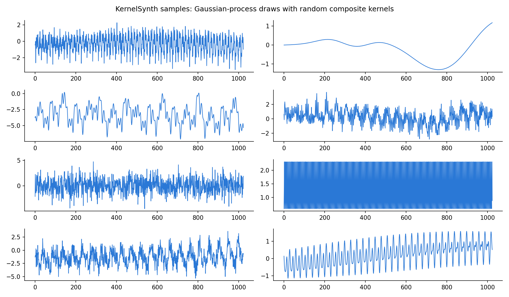
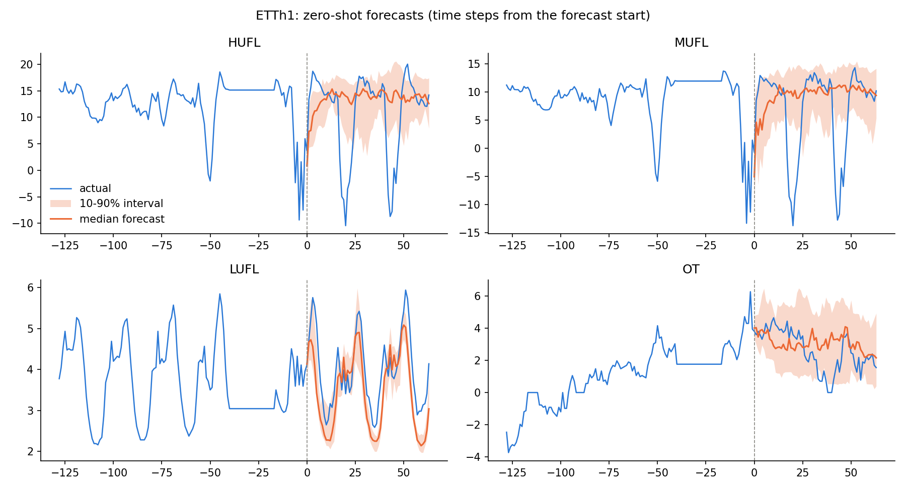
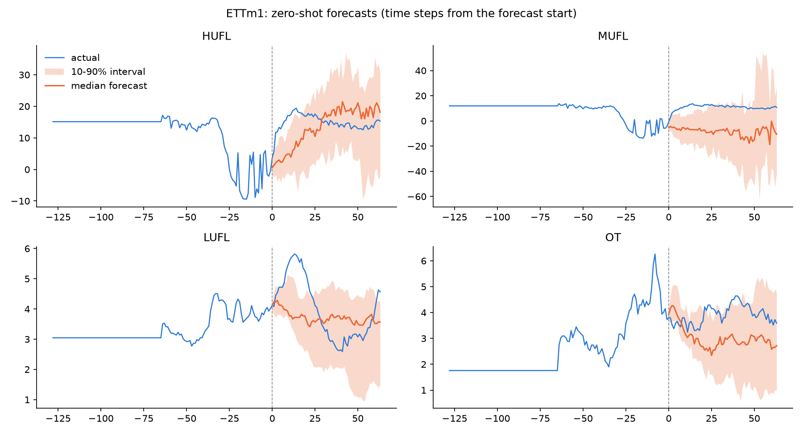

# tiny-chronos

[](https://github.com/Magikdidi24/tiny-chronos/actions/workflows/tests.yml)

A small version of [Chronos](https://arxiv.org/abs/2403.07815), the model that does time series forecasting as language modeling: you scale the series, cut the values into bins and train a transformer to predict the next bin. Mine has 5.35M params and is trained only on synthetic data. I test it zero-shot on ETTh1 and ETTm1.

## How it works

The training data comes from KernelSynth, the generator from the Chronos paper. Each series is a sample from a Gaussian process with a random kernel, made of 1 to 5 basic kernels (linear, RBF, periodic, noise...) combined with `+` or `*`. `synth.py` makes 100k series of 512 points in about 20 s.



To tokenize a window I divide it by the mean absolute value of its context and cut [-15, 15] into 1024 uniform bins. The model is a small decoder-only transformer (6 layers, width 256) instead of the T5 used in Chronos, trained with plain cross-entropy on windows of 256 context points + 64 to predict. 20k steps of 64 windows, so 408M tokens, which takes about 7 min on my RTX 5070 Ti.

To forecast it samples the next 64 tokens one by one, 20 paths per series. The median of the paths is the point forecast and the quantiles give the probabilistic one.

## Results

Evaluated on the last 20% of ETTh1 (hourly) and ETTm1 (every 15 min), 10 windows per column, horizon 64. The baselines are seasonal naive (repeat the last day) and naive (repeat the last value). The rel. columns are the geometric mean of the ratio to seasonal naive, like in the paper, lower is better.

| dataset | method | MASE | WQL | rel. MASE | rel. WQL |
|---|---|---|---|---|---|
| ETTh1 | tiny-chronos | 1.405 | 0.345 | 1.257 | 1.006 |
| ETTh1 | seasonal naive | 1.114 | 0.335 | 1.000 | 1.000 |
| ETTh1 | naive | 1.746 | 0.544 | 1.558 | 1.558 |
| ETTm1 | tiny-chronos | 1.329 | 0.333 | 1.220 | 0.962 |
| ETTm1 | seasonal naive | 1.070 | 0.316 | 1.000 | 1.000 |
| ETTm1 | naive | 1.796 | 0.584 | 1.469 | 1.469 |

So it doesn't beat seasonal naive. The point forecasts are 22-26% worse on MASE. On WQL it's about a tie: rel. WQL is 1.01 on ETTh1 and 0.96 on ETTm1, even if the plain average is 3-5% worse on both. WQL is kinder to it because it scores the whole spread of the samples, while seasonal naive only gives one line. It does clearly beat plain naive.



ETTh1 has these sharp dips every day. Seasonal naive just copies them from the day before, but on HUFL and MUFL my model predicts something flat around the mean and the dips aren't even inside its 10-90% band.



On ETTm1 the MUFL forecast is just wrong: it predicts around -10 while the real value stays near 10, probably because the context ends right after a big drop.

Real data in the training mix would be the first thing to add. Chronos trains on a lot of it, and Gaussian processes don't really make spikes or sudden level changes like these. The eval is also small and doesn't follow the paper's protocol, so these numbers can't be compared with the ones in the Chronos paper.

## Running it

I ran it on my 5070 Ti, on CPU the full training would take forever.

```bash
pip install -r requirements.txt
python synth.py --plot      # data/synth.npy and assets/synthetic_samples.png
python train.py --compile   # out/ckpt.pt
python evaluate.py          # downloads ETT, writes out/eval.json and the forecast plots
```

The tests don't need any data (`pytest -q`). For a quick CPU run with a tiny model:

```bash
python synth.py --n 2000
python train.py --dim 64 --n_layers 2 --max_steps 50 --warmup_steps 10 --eval_every 25
python evaluate.py --quick
```
